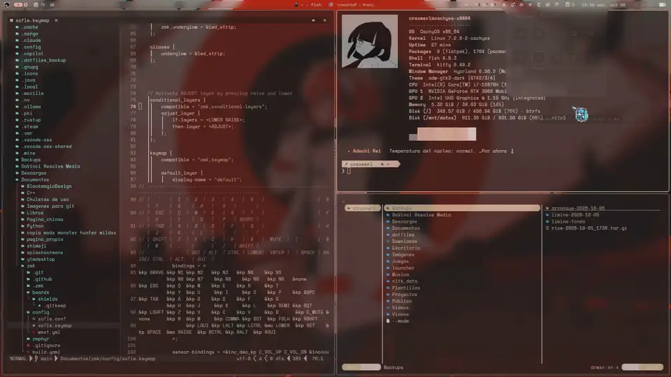
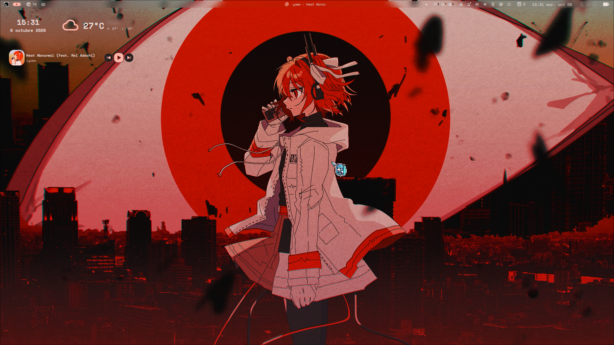
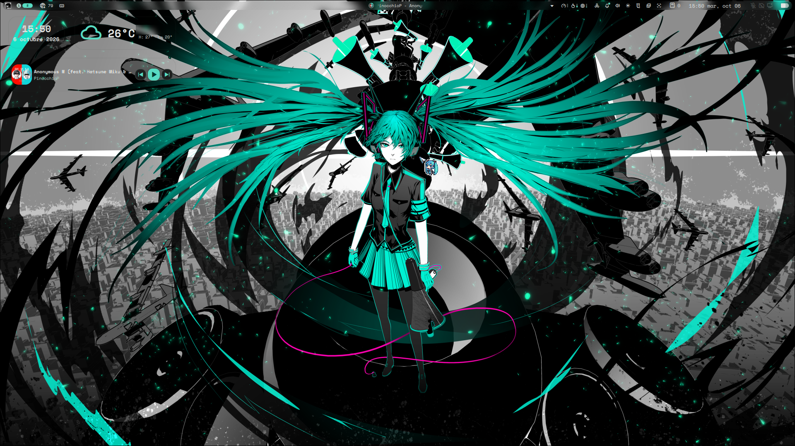
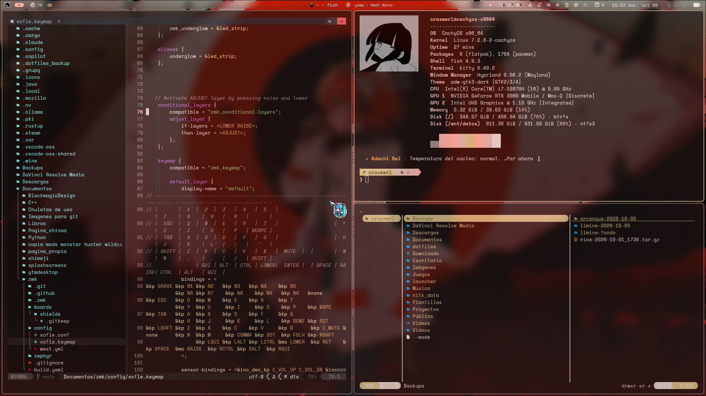
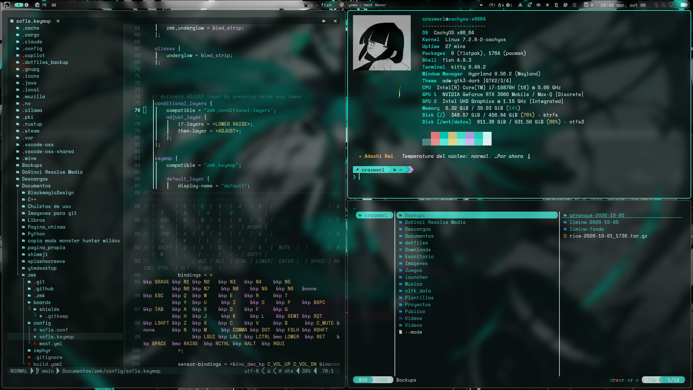
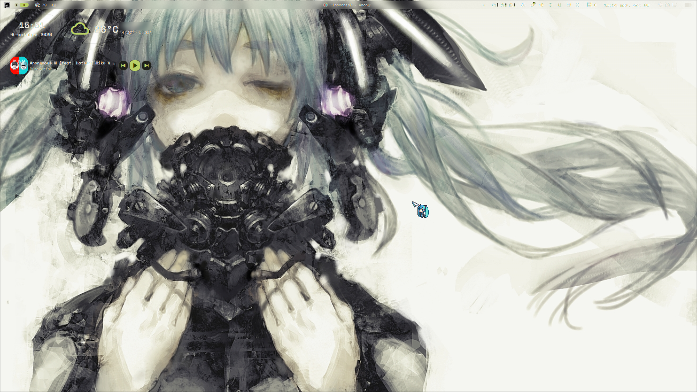
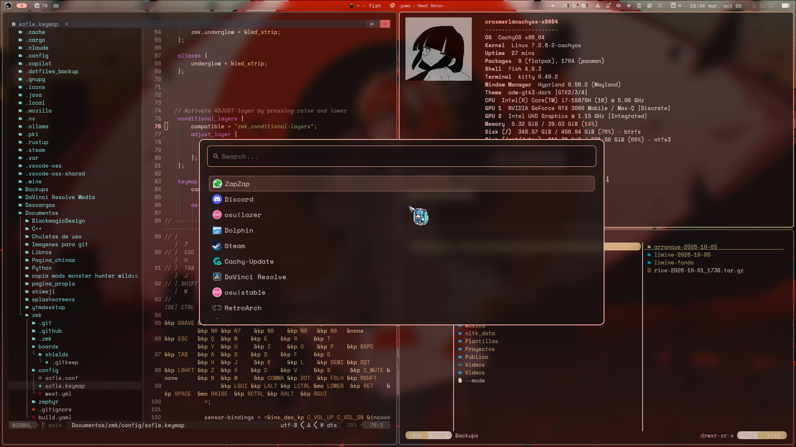
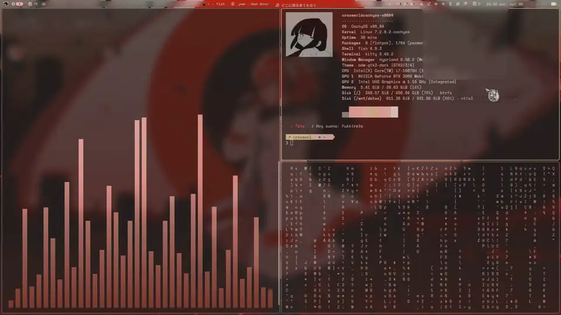
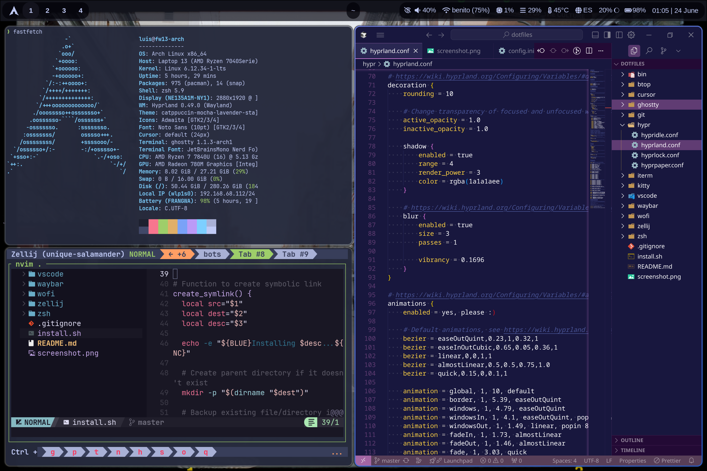

# Crasmerl - Dotfiles

Archivos de configuración personales para mi setup de CachyOS (Arch) con Hyprland y Noctalia. Los colores de todo (bordes, terminal, Neovim, wofi, tmux, Discord, Firefox…) cambian según el fondo de pantalla. Siéntete libre de usarlos o coger inspiración.

Úsalos bajo tu propia responsabilidad.

Todo esto empezó a partir de los dotfiles de **Luis Mendoza**: [luismendozamx/dotfiles](https://github.com/luismendozamx/dotfiles). ¡Gracias por la base!

> [!NOTE]
> **Versión de Noctalia: esta configuración es para Noctalia 5.x** (paquete `noctalia`, el que trae CachyOS por defecto en Hyprland). Está en `noctalia-v5/`.
>
> - La config de la **4.x** (`noctalia-shell` + `noctalia-qs`, basada en Quickshell/Qt) sigue en `noctalia-v4/` por si alguien la quiere, pero ya no la uso.
> - **Qt 6.12 rompe Noctalia 4.x**: Qt añade su propio `Color` en QML, que tapa el de Noctalia, y la barra se queda en negro. Por eso me pasé a la 5.
> - `bin/noctalia-cambiar 5|4` cambia entre las dos versiones (arranque, bloqueo de pantalla y esquina activa).



## Capturas

| | |
|---|---|
|  |  |
|  |  |
|  |  |



<details>
<summary>Así empezó todo (mayo 2026)</summary>



</details>

## Instalación

```bash
mkdir -p ~/dev/config
git clone https://github.com/Crasmerl/dotfiles.git ~/dev/config/dotfiles
cd ~/dev/config/dotfiles
./install.sh
```

El script de instalación:

- Crea los symlinks de todo (configs en `~/.config` y scripts de `bin/` en `~/.local/bin`) y guarda lo que ya tuvieras en `~/.dotfiles_backup/<fecha>/`.
- Copia la config de Noctalia 5 solo si no tienes una, cambiando mis rutas (`/home/crasmerl`) por tu `$HOME` y el monitor `eDP-1` por el tuyo (si Hyprland está abierto).

> [!IMPORTANT]
> Algunas cosas son de mi equipo y tendrás que cambiarlas a mano:
> - `hypr/config/monitores.lua`: mis monitores (portátil, HDMI y la tableta XP-Pen).
> - Los fondos se buscan en `~/Imágenes/Fondos`, y `bin/colores-fondo` usa `background.png` como fondo con los colores de siempre.
> - `bin/modo-silencioso` controla los ventiladores con nbfc, pensado para mi portátil.

## Requisitos

**Base:**

- Hyprland
- Noctalia **5.x** (ver aviso arriba)
- fish + Starship
- tmux
- Kitty
- Neovim (NvChad)
- wofi
- eza, fzf, bat
- fastfetch, btop, yazi, thefuck

**Para los scripts y los colores según el fondo:**

- `jq`, `socat`, `python`
- `cliphist` y `wl-clipboard` (portapapeles, SUPER+SHIFT+V)
- `libqalculate` (`qalc`, calculadora, SUPER+C)
- `libnotify` (`notify-send`)
- `adw-gtk-theme` (tema GTK con los colores del fondo)
- `cava` (visualizador de audio)
- `mpvpaper` (fondo de vídeo), `playerctl`, `brightnessctl`, `wireplumber` (`wpctl`)

**Opcionales:**

- [Pywalfox](https://github.com/Frewacom/pywalfox) para Firefox y Vesktop para Discord, si quieres que también cojan los colores
- `nbfc-linux` para `modo-silencioso`

## Qué incluye

| Carpeta | Descripción |
|---|---|
| **hypr/** | Hyprland en Lua: `hyprland.lua` carga las partes de `config/` (monitores, programas, apariencia, entrada, atajos, reglas); `hyprland.conf` queda de copia, hypridle y fondo de vídeo con audio que baja cuando hay ventanas |
| **noctalia-v5/** | Noctalia 5: `config.toml`, plantillas de colores según el fondo, iconos y ajustes de la ventana de Ajustes (`settings-gui.toml`). Se copia, no se enlaza. En `keybind-cheatsheet/` está el parche del keymap (nombres de teclas y orden Super+Shift): tras actualizar el plugin, ejecutar `aplicar.sh` |
| **noctalia-v4/** | Config antigua de Noctalia 4.x (ya no se usa) |
| **fish/** | Shell fish con frases y avisos de personajes (Miku, Teto, Adachi Rei…) |
| **starship/** | Prompt estilo powerline |
| **tmux/** | Multiplexor de terminal (uso desde el iPad por SSH) |
| **nvim/** | Neovim con NvChad, tema propio *cenote* y colores según el fondo |
| **kitty/** | Kitty con estela del cursor, colores según el fondo y barra de chuletas abajo (`tab_bar.py`) que cambia al mantener Ctrl, Ctrl+Shift o Alt |
| **chuletas-teclado/** | Servicio (root) que avisa a kitty de qué tecla Ctrl/Shift/Alt está pulsada. Instalar: copiar el script a `/usr/local/bin/`, el `.service` a `/etc/systemd/system/` y `systemctl enable --now chuletas-teclado` |
| **fastfetch/** | Info del sistema al abrir la terminal con logo personalizado |
| **btop/** | Monitor del sistema con tema de Noctalia |
| **wofi/** | Lanzador de aplicaciones: sube desde abajo al abrir, búsqueda aproximada, acciones de las apps (→), calculadora y portapapeles |
| **thefuck/** | Configuración del corrector de comandos |
| **yazi/** | Gestor de archivos en terminal |
| **bin/** | Scripts: `colores-fondo` (colores según el fondo), `esconder-ventanas` (esquina activa), `ventanas-flotantes` (SUPER+F), `wofi-calculadora` (SUPER+C), `wofi-portapapeles` (SUPER+SHIFT+V), `modo-silencioso` (ventiladores), `noctalia-cambiar`. Funcionan con la config en Lua y con la antigua |
